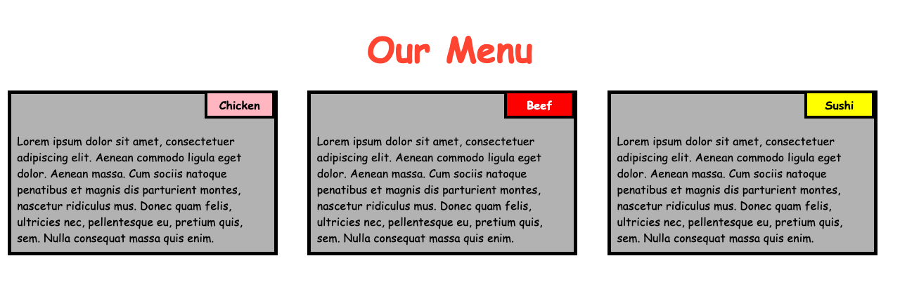
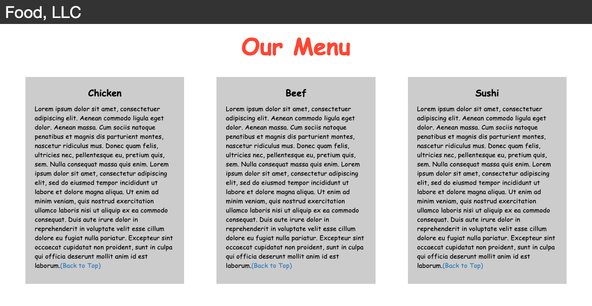
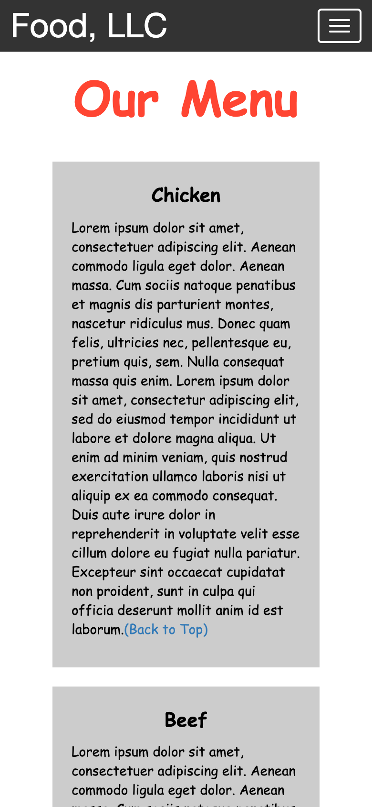

<div align="center">

# HTML, CSS and JavaScript for Web Developers

My solutions to the weekly assignments of the Coursera course *HTML, CSS, and Javascript for Web Developers* (Johns Hopkins University).

    

</div>

## Assignments

| Folder | Topic | What it does |
| --- | --- | --- |
| [Week&nbsp;2](Week-2) | Responsive layout with CSS | A three-section menu page built with floats and media queries: three columns on desktop, two plus one full-width on tablets, and one column on phones |
| [Week&nbsp;3](Week-3) | Responsive layout with Bootstrap | The same page rebuilt with the Bootstrap grid, plus a navbar that collapses into a menu button on small screens |
| [Week&nbsp;4](Week-4) | JavaScript basics | Uses immediately invoked function expressions to print "Hello" or "Good Bye" for each name in a list, depending on whether it starts with "J" |
| [Week&nbsp;5](Week-5) | AJAX and Bootstrap | Starter code for the "David Chu's China Bistro" restaurant website; the AJAX steps are not completed |

## Screenshots

### Week 2: Responsive layout with CSS

<table>
  <tr><th>Desktop</th></tr>
  <tr><td></td></tr>
</table>

### Week 3: Responsive layout with Bootstrap

| Desktop | Phone |
| :---: | :---: |
|  |  |

## Running locally

No build step is needed. Open any assignment's `index.html` in a browser:

```bash
open Week-3/index.html
```

Week 4 prints its output to the browser's developer console. Week 5 loads its page sections with AJAX, so serve it from a local web server instead:

```bash
python3 -m http.server 8000
```

Then open [http://localhost:8000/Week-5/](http://localhost:8000/Week-5/).

## Branches

| Branch | Contents |
| --- | --- |
| `master` | All assignments |
| `Week-2` | An earlier snapshot containing the Week 2 to Week 4 assignments |
